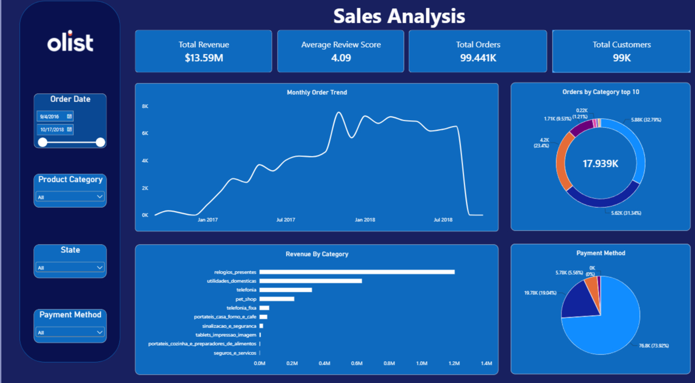
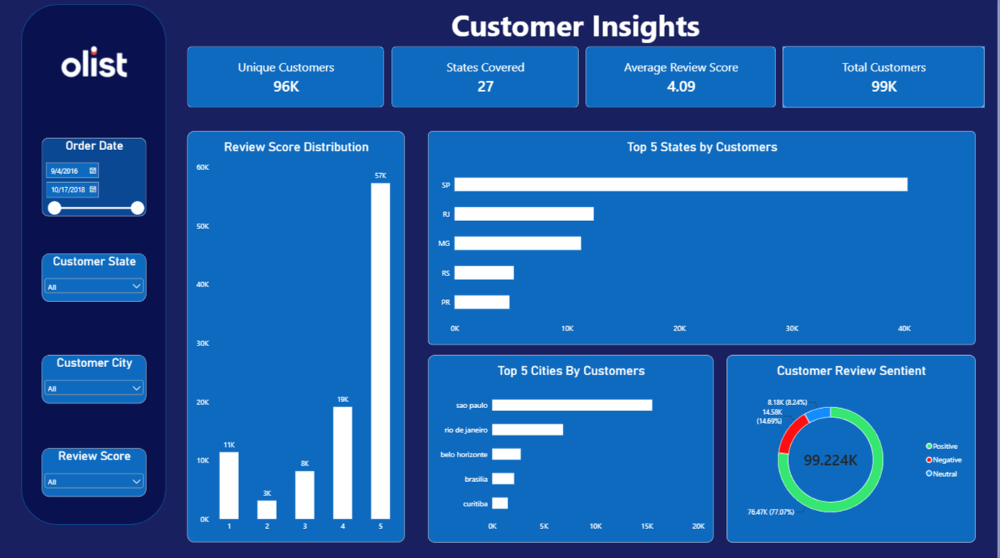

# Olist-Data-Analysis-Project
Analysis of Brazillian E-commerce platform "Olist" data using Excel, MySQL and Power BI to identify sales trends, performace, customer happiness and regional revenue

I worked with the Olist Brazilian E-Commerce Public Dataset to look at how businessesre performing. I checked sales numbers, product categories, where customers are located how people pay and how satisfied customers are.

I used SQL in MySQL to explore and analyze datasets. I joined tables, grouped data, filtered results and used subqueries to get the information I needed.

Then I built dashboards in Power BI. These dashboards helped track revenue order trends how products are doing, where customers come from and patterns, in customer reviews.

The goal was to turn e-commerce data into useful business insights. I wanted to find out what drives revenue understand customer behavior and help make business decisions.

This project looks at the following questions:

- Which product categories generate the revenue?

- How do order volumes vary over time?

- Which geographical markets bring the highest revenue?

- What payment methods do customers prefer?

- How satisfied are customers, with their purchases?

**Tools Used**
MySQL: Data exploration, joins, aggregations, subqueries and business analysis.
Power BI: Data modelling, DAX measures, interactive dashboards and visualisation.
Microsoft Excel: data inspection and validation.

**Analytical Workflow**

**1. Data Exploration & Preparation**
- Explored several datasets from the Olist e-commerce database.
- examined data structures, record counts and how tables relate to each other.
- checked data consistency and validated records.
- used SQL joins to combine customer order, product, payment and review information.

**2. SQL Analysis**
- looked at revenue. Monthly order trends.
- identified performing product categories.
- examined customer and revenue distribution.
- evaluated payment method preferences.
-looked at customer review scores and satisfaction patterns.

**3. Power BI Dashboard Development**
- set up relationships between datasets.
- created DAX measures, for performance indicators.
- built dashboards covering sales performance and customer insights.
- added slicers for date product category, geographical location, payment method and review score.

 Dashboard Preview
#### 1. Sales Analysis

#### 2. Customer Insights

**Key Business Insights**
- Overall Revenue: I found that Olist made about 13.59 million BRL from 99.44 thousand orders.
- Highest Revenue Generating State : Sao Paulo is the highest revenue generating state which is relative to it being the most populous state in Brazil followed by Minas Gerais and Rio De Janeiro for the exact same reasons
- Product Performance: The relogios_presentes (watches & gifts) category earned about 1.2 million BRL making it the highest revenue source.
- Geographical Distribution: São Paulo had the largest group of customers with around 40k customers. This is because Sao Paulo is the most populous state in Brazil
- Customer Satisfaction: The average rating was 4.09 out of 5.
- Review Distribution: About 57 thousand five‑star ratings were given.
- Customer Sentiment: About 77.07 percent of reviews were positive 14.69 percent were neutral and 8.24 percent were negative.

**Business Recommendations**
- Focus on high-revenue product categories when setting inventory levels and planning marketing efforts.
- Look into opportunities in regions outside of São Paulo.
- Keep an eye on review scores to spot possible problems with customer experience.
- Use data, on payment preferences to improve how customers check out.
- Track order trends to help with planning future demand.

**Project Limitations**
The dataset does not contain product and operational cost information. Because of that the analysis focuses on revenue rather than actual profitablity.
Customer review scores serve as a stand‑in for customer satisfaction
Sentiment classification relies on review scores. Scores of four or five positive sentiment a score of three means neutral sentiment and scores of one or two mean negative sentiment.

**Conclusion**
This project demonstrates an end-to-end data analytics workflow, using SQL to extract and analyse business information and Power BI to communicate findings through interactive dashboards.
It highlights how data analytics can help e-commerce businesses understand sales performance, identify key markets, evaluate customer satisfaction, and make data-driven decisions.

**Dataset Link** :- https://www.kaggle.com/datasets/olistbr/brazilian-ecommerce
